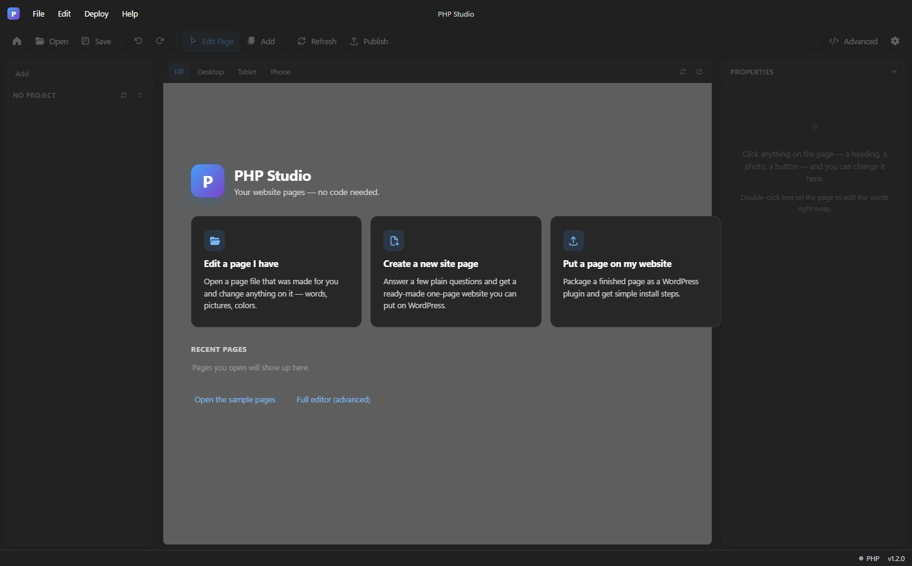
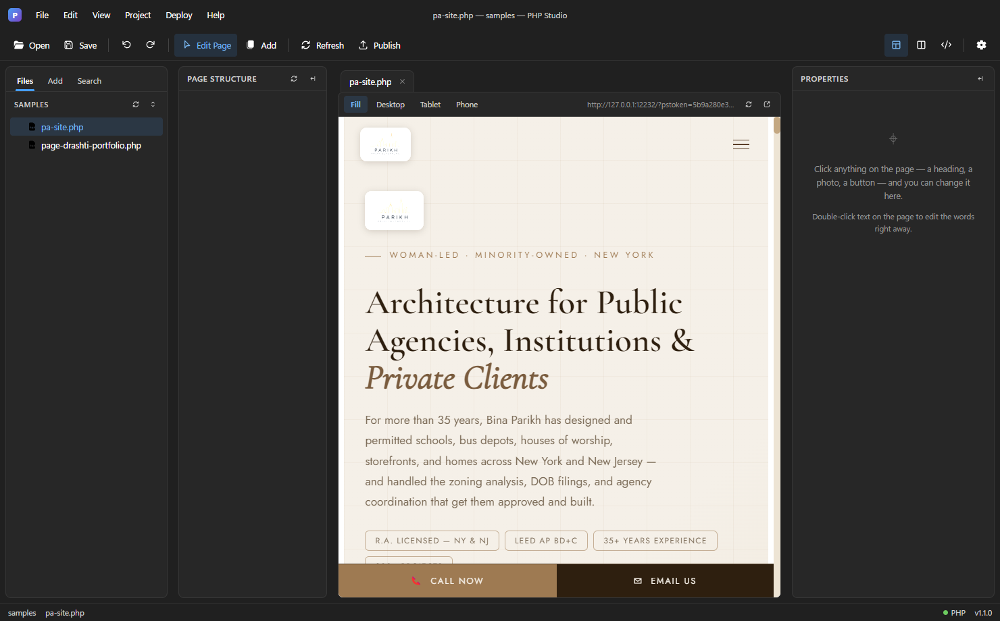
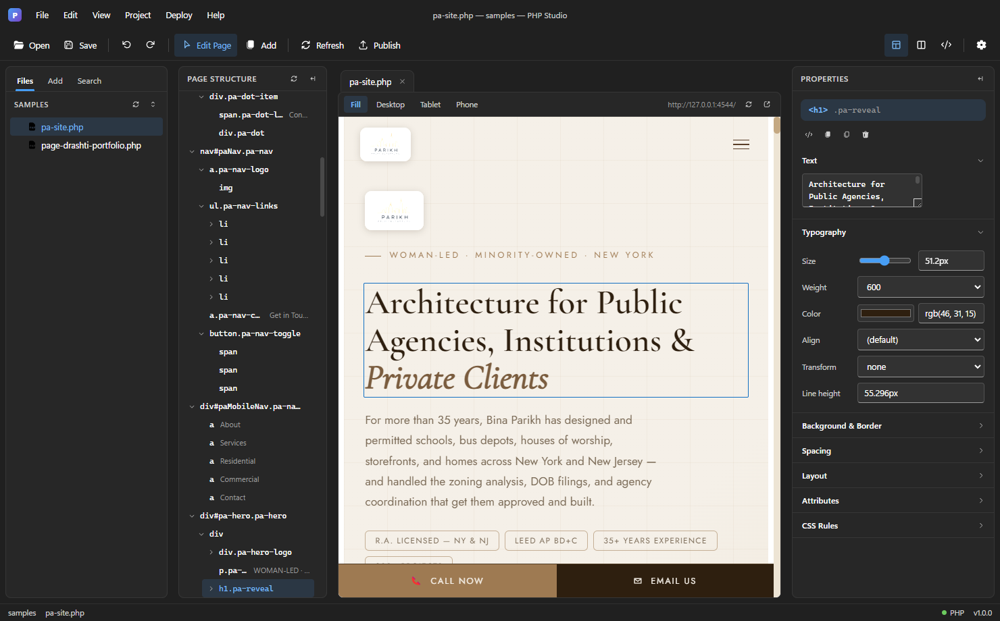

# PHP Studio

A visual editor for PHP/WordPress-style site pages — click anything on the
page and edit it, no code required, but the code view is still there if you
want it. I built it for editing single-file PHP landing pages for client
sites (like the one under `samples/`) without opening a code editor every
time I needed to swap a headline or a photo.



## What it does

- **Click-to-edit pages.** Click any heading, photo, button, or block on the
  live page and change it from a Properties panel — no code needed.
  Double-click text to edit it right on the page.
- **Live preview** at Desktop/Tablet/Phone widths, backed by a real local
  PHP server (`shim/`) so the preview is the actual PHP output, not a guess.
- **Advanced/code view** (Monaco editor) for when you want to hand-edit the
  PHP/HTML/CSS directly, alongside the visual view.
- **Deploy** — package a finished page as a WordPress plugin, or publish
  straight to a site over FTP.
- **Safety net** — project backups on open, rolling autosave snapshots, and
  a plain-English change diary ("Changed the text color of the big heading
  to #0F6CBD") written to a changelog file per project, all kept in a
  visible `Desktop\PHP Editor` folder rather than hidden away.
- Windows 11 Fluent-styled UI, packaged as a portable Electron app.



## How it's built

Electron app (`main/main.js`, `renderer/`) driving a bundled portable PHP
runtime to actually render and serve the pages you're editing, so what you
see in the preview is real PHP output rather than a static approximation.
Monaco provides the code view; `basic-ftp` handles publishing.

## Running from source

```bash
npm install
npm start
```

Needs a portable PHP runtime dropped into `php/` (this repo doesn't ship
the PHP binaries themselves — grab a Windows PHP build from
[windows.php.net](https://windows.php.net/download) and extract it there).

## Building the portable EXE

```bash
npm run dist
```

Uses `electron-builder` to produce a portable Windows exe. Monaco and the
PHP shim ship as `extraResources` (outside the asar archive) since `php.exe`
needs to read them as real files on disk.



## Layout

- `main/` — Electron main process (window, PHP process management, FTP deploy)
- `renderer/` — the editor UI (HTML/CSS/JS)
- `shim/` — local PHP server shim used for live preview
- `samples/` — example pages used for testing/demoing
- `php/` — portable PHP runtime (not included in this repo, see above)
